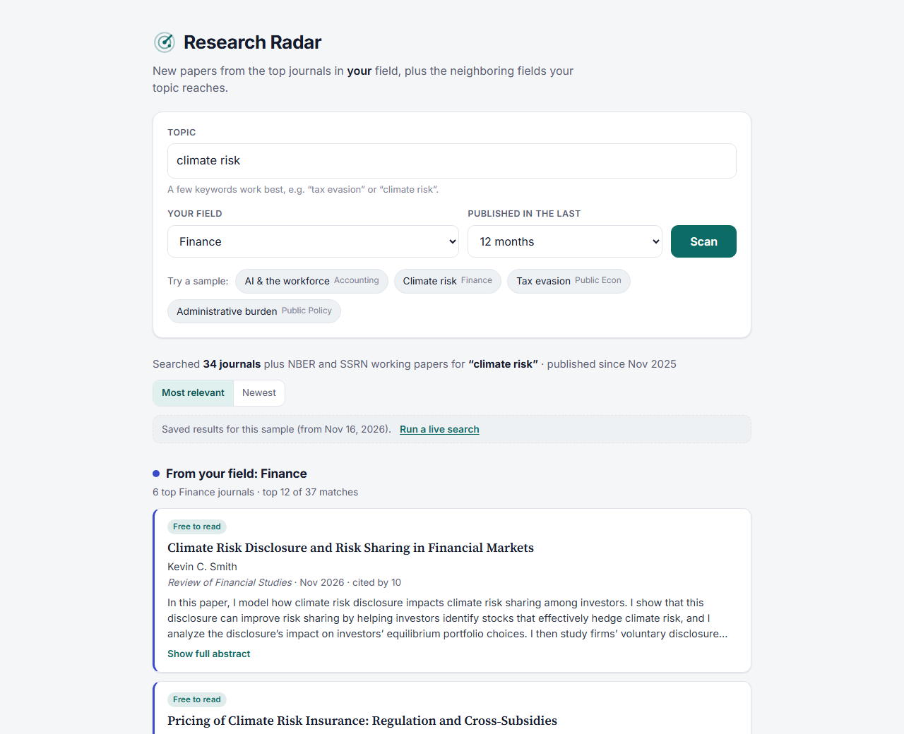

# Research Radar

New papers from the top journals in **your** field, plus the neighboring fields your topic reaches.

**Live site:** coming soon (GitHub Pages)



Research Radar is a small web app for researchers and policy students working in business (accounting, finance) and public policy and economics. Type a topic, pick your home field, and it shows three lists:

1. **From your field**: the best matches in your field's top journals.
2. **From neighboring fields**: matches in the other fields' top journals. The topic decides which fields appear, so the "spillover" changes from topic to topic.
3. **New working papers**: the newest NBER and SSRN working papers on the topic, which often circulate long before the journal version. SSRN papers are shown only if at least one author has published in the listed journals.
4. **Shared on Bluesky**: links (news reports, papers, policy reports) that people shared in public Bluesky posts about the topic over the last 30 days, ranked by how many accounts shared them.

## Try it

- Click a sample topic: *AI & the workforce*, *Climate risk*, *Tax evasion* or *Administrative burden*. Samples load instantly from saved results.
- Or type a few keywords (for example `ESG disclosure`), choose your field and a time window, and press **Scan** for a live search.
- Links are shareable: the address bar keeps your topic, field and time window.

## How it works

- **Data:** the free, open [OpenAlex](https://openalex.org) API (CC0 data), called directly from the browser, plus Crossref for SSRN abstracts. There is no server and no account. The only things stored are a short-lived search cache and an optional API key, both in your own browser.
- **Quality control:** each field has a short list of top journals (`journals.js`). Limiting the search to these journals is the main quality filter; an open OpenAlex search returns many papers from low-quality outlets.
- **Searches per scan:** your field's journals, all other fields' journals, NBER working papers, and SSRN.
- **SSRN quality filter:** SSRN has no quality screen, so Research Radar takes the 50 best SSRN keyword matches, keeps those that appeared inside your time window, and then keeps only papers with at least one author who has published in the listed journals ("trusted authors", the counterpart of the trusted journals). This costs one small extra lookup.
- **SSRN abstracts:** OpenAlex doesn't carry them, but SSRN deposits them with [Crossref](https://www.crossref.org), whose open API allows calls from web pages. Research Radar fetches them in one batch request. (SSRN's own site blocks automated access, and Research Radar never contacts it.)
- **Bluesky:** one call to Bluesky's public search (no key needed) for the 100 top posts of the last 30 days that mention the topic. Only posts with a link count; GIF, video, music, social-media and shortened links are ignored. Posts are grouped by the page they link to, each account counts once per link, and links are ranked by how many accounts shared them. Links to known news, research and policy sites (any `.gov` site counts as policy) are labeled and shown first; the rest are folded. Only links and counts are shown, never account names or post text. The site lists are in `journals.js`.
- **Ranking:** within each list, papers whose title or abstract contain your keywords come first. Papers that only match in the full text are tagged *Weaker match* and folded under "Show more".

## Fields and journals

| Field | Journals |
|---|---|
| Accounting | The Accounting Review; Journal of Accounting Research; Journal of Accounting and Economics; Contemporary Accounting Research; Review of Accounting Studies; Accounting, Organizations and Society; Journal of Accounting and Public Policy |
| Finance | Journal of Finance; Journal of Financial Economics; Review of Financial Studies; Journal of Financial and Quantitative Analysis; Review of Finance; Journal of Corporate Finance |
| Public Policy & Administration | Journal of Policy Analysis and Management; Public Administration Review; Journal of Public Administration Research and Theory; Policy Studies Journal; Health Affairs; World Development |
| Public Economics | Journal of Public Economics; AEJ: Economic Policy; National Tax Journal; International Tax and Public Finance |
| Applied Economics (labor, health, development, environment) | Journal of Labor Economics; Journal of Health Economics; Journal of Development Economics; Journal of Environmental Economics and Management; Journal of Urban Economics |
| General-Interest Economics | American Economic Review; Quarterly Journal of Economics; Journal of Political Economy; Econometrica; Review of Economic Studies; AEJ: Applied Economics |
| Working papers | NBER Working Papers; SSRN (only authors who have published in the journals above) |

## Limitations

- **Keyword search, not meaning.** Synonyms matter ("tax compliance" vs. "tax evasion"), and a paper can match because its abstract mentions your topic in passing.
- **Only the listed journals.** Strong work elsewhere will not appear.
- **SSRN data is thin.** SSRN shares only the posting year, so the date shown is when OpenAlex first listed the paper. A few SSRN papers have no abstract in Crossref; those are judged on their title alone. The author filter can drop good papers by researchers new to these journals, and OpenAlex occasionally merges two people with the same name. Remove the `ssrn` entry in `journals.js` to turn SSRN off.
- **Bluesky reflects Bluesky.** The list works best for topics in the news (e.g. climate risk, AI and jobs); niche research topics (e.g. ESG disclosure, tax evasion) may show few or no links. It shows what is popular among Bluesky users, who are not a representative sample of anyone.
- **Busy periods.** When OpenAlex is under heavy load it pauses searches made without a key for about a minute (HTTP 429 with a "retry in N seconds" message). Research Radar retries short waits automatically and otherwise says how long to wait; a free key avoids this.
- **Daily budget.** Without a key, OpenAlex allows roughly 25 scans a day per network (everyone on the same Wi-Fi shares it). Sample topics never use it. A free key (from [openalex.org/settings/api](https://openalex.org/settings/api)) raises the limit; paste it under *How it works → Daily search limit*. It is stored only in your browser.
- **Missing abstracts.** Some publishers do not share abstracts with OpenAlex.

## Run it locally

```bash
python -m http.server 8000
```

Then open <http://localhost:8000>.

## Customize

- **Journals and fields:** edit `journals.js`. Journals are identified by OpenAlex source IDs; find one at `https://api.openalex.org/sources?search=JOURNAL NAME`.
- **Sample topics:** listed in `journals.js`; their saved results are the files in `samples/`.

## Files

| File | What it does |
|---|---|
| `index.html` | Page structure and the "How it works" text |
| `styles.css` | Layout, light and dark themes |
| `app.js` | Search, ranking and rendering logic |
| `journals.js` | Fields, journal lists and sample topics |
| `samples/` | Saved results for the sample topics |
| `docs/screenshot.png` | The screenshot at the top of this page |

## Credits

Built with Claude Code for DPI-681 *The Science and Implications of Generative AI* (Harvard Kennedy School, Fall 2026). Paper data from OpenAlex (CC0); SSRN abstracts from Crossref; shared links from Bluesky's public search.
